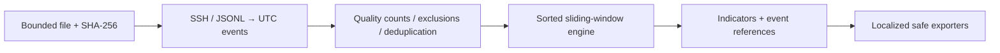

# AuthLens

**Offline authentication triage with evidence you can inspect.**

[Español](README.es.md) · [Русский](README.ru.md) · [简体中文](README.zh-CN.md)

Python 3.11+ · MIT · v0.1.0 · no runtime dependencies

AuthLens reads a local authentication export, correlates time windows, and produces explainable indicators with source hashes and line references. It makes no network connections and does not attempt logins or block accounts. **An indicator is a lead for investigation, not proof of compromise.**

Status: local release candidate. See [verified results and remaining release gates](docs/release-readiness.md). Public CI badges will be added only after a real repository and workflow exist.

## Why this project exists

A small incident investigation should not require uploading sensitive logs or deploying a SIEM. AuthLens concentrates on reproducible file analysis: which records contributed to a result, what was excluded, and what the evidence cannot establish.

## Features

- SSH auth-line parser and a strict normalized JSONL interchange schema.
- Inclusive UTC windows: repeated failures, failures across accounts, success following failures.
- Host/service/source isolation, explicit exclusions, duplicate accounting and input-quality diagnostics.
- Stable finding IDs, source SHA-256, bounded event evidence and human investigation guidance.
- Text, JSON, CSV, Markdown and self-contained HTML reports.
- English, Spanish, Russian and Simplified Chinese CLI and report narratives.
- Bounded input, exclusive output creation, structured lifecycle logs and scripting-friendly exit codes.

## Screenshots / Demo

The synthetic demo uses documentation IP addresses and needs no external server:

```console
authlens analyze examples/ssh-demo.log --input-format ssh --format json
```

Expected indicators, checked against [the fixture contract](examples/expected-findings.json):

| Rule | Priority | What the demo contains |
|---|---|---|
| AL-001 | MEDIUM | Five failures for alice from 192.0.2.10 |
| AL-003 | HIGH | A subsequent successful login for that exact account/source |
| AL-002 | MEDIUM | Five different accounts failing from 198.51.100.20 |

Create a report you can open locally:

```console
authlens analyze examples/events.jsonl --format html --output authlens-demo.html --lang en
```

## Architecture



The detector is pure Python and independent of CLI/reporting. It uses deques and account counters; an independent brute-force test oracle checks its behavior. Read [architecture](docs/architecture.md), [rule semantics](docs/detection-logic.md), and [design decisions](docs/adr/0001-language.md).

## Installation

Use a maintained Python 3.11–3.14 interpreter. The source is intended for Linux, Windows and macOS; local verification was performed on Windows/Python 3.12. Public cross-platform CI remains a separate gate.

From this repository directory, on Linux/macOS:

```sh
python3 -m venv .venv
. .venv/bin/activate
python -m pip install .
```

On Windows PowerShell:

```powershell
py -3 -m venv .venv
.venv\Scripts\python.exe -m pip install .
.venv\Scripts\authlens.exe --help
```

Use `.venv\Scripts\authlens.exe` in place of `authlens` if you do not activate the environment. Installation may download build tools; runtime is offline. No PyPI publication is claimed. See [installation and wheel verification](docs/installation.md).

## Quick Start

```console
authlens analyze examples/events.jsonl --lang en
authlens analyze examples/events.jsonl --format json --output report.json
authlens analyze examples/events.jsonl --lang es --format html --output informe.html
```

Each output filename must be new. Keep reports in a private directory; identities and IPs remain visible.

## Usage

```console
authlens analyze --help
authlens analyze examples/events.jsonl --window-seconds 60 --burst-threshold 5
authlens analyze examples/events.jsonl --exclude-cidr 198.51.100.0/24 --exclude-user healthcheck
authlens analyze examples/events.jsonl --format csv --output report.csv --log-file run.log
authlens analyze examples/events.jsonl --strict --fail-on MEDIUM --format json
authlens analyze auth.log --input-format ssh --year 2026 --timezone=-03:00
```

`--fail-on` is optional. Codes: **0** complete; **1** configured finding threshold reached; **2** arguments/configuration; **3** I/O or resource limit; **4** malformed/partial or no analyzable records; **130** cancellation. Partial-input status takes precedence over findings. JSON/CSV go to stdout without progress messages. Diagnostics go to stderr. `--quiet` preserves the requested report and errors; `--verbose` adds completion counts. Text is already color-free.

## Output

JSON schema version `1.0` contains tool version, creation time, source SHA-256, counters, diagnostics, effective settings and findings. Each finding separates observation, inference, hypothesis, recommendation and benign explanations. It carries `DERIVED` evidence, `indicator` classification, severity, qualitative confidence, rule version, thresholds, ATT&CK references and up to 20 event references. Evidence truncation is explicit. Machine keys, IDs and enums do not translate.

The first threshold-reaching episode per rule/group is reported; later episodes in the same input are not enumerated. JSON is the authoritative format. Empty CSV has only headers, so use JSON to retain quality information when there are no findings. [Report schema](docs/report-schema.json).

## Configuration

Pass `--config examples/config.toml`. Priority: CLI > explicit TOML > defaults. Unknown keys, wrong types and out-of-range values fail. No implicit config discovery. Defaults: 300-second window, thresholds 5, 16 MiB input, 16 KiB per line, 50,000 accepted records. Limits count bytes before decoding and accepted records before exclusion/deduplication. [Complete configuration reference](docs/configuration.md).

## Languages

Use `--lang en`, `--lang es`, `--lang ru`, `--lang zh-CN`, or TOML `language = "es"`. Without selection, AuthLens checks OS locale and falls back to English. Catalogs are installed inside the package and checked for matching keys/placeholders. Translation review contributions are welcome; native-speaker certification is not claimed.

## Security

No raw log lines or SSH suffixes in reports. No identities, paths or input content in lifecycle logs. Report fields are escaped; CSV formula prefixes are neutralized. Output files are exclusively created, never overwritten. POSIX uses mode 0600; Windows relies on directory ACLs. Use operator-controlled directories. Read [SECURITY.md](SECURITY.md) and [THREAT_MODEL.md](THREAT_MODEL.md).

## Scope / Authorization

Analyze only logs you own or are authorized to handle. Scope here is a local file plus explicit exclusions, not a network target. Input exports should be immutable. The hash identifies processed bytes; it does not authenticate a log source or establish chain of custody.

## Limitations

Supports the documented SSH grammar and JSONL schema, not arbitrary syslog or EVTX. Traditional SSH timestamps require year and fixed offset; decreasing timestamps are rejected, with no guessed year rollover or DST. No location, reputation, baseline learning, distributed/slow attack detection or attribution. Incomplete collection, clock skew and coarse timestamp precision affect results. Exact duplicate removal can merge genuine identical events; use `--keep-duplicates` deliberately. Bounds reduce risk but do not guarantee a fixed memory budget or prove absence of attacks.

## False Positives

Retries, expired automation credentials, shared NAT, QA and SSO incidents can mimic attacks. A success after failures can be legitimate recovery. Multi-account failures do not reveal attempted passwords and cannot confirm password spraying. MEDIUM/HIGH are documented triage priorities, not CVSS. [Detection logic and counterexamples](docs/detection-logic.md).

## Development

```console
python -m pip install -r requirements-dev.txt
python -m pip install -e .
python -m ruff check src tests scripts evaluation
python -m ruff format --check src tests scripts evaluation
```

Follow [CONTRIBUTING.md](CONTRIBUTING.md). New detectors need a concrete use case, counterexamples, evidence semantics and tests before implementation. No speculative plugin framework.

## Testing

```console
python -m pytest --cov=authlens --cov-report=term-missing
python -m bandit -r src -q
python -m pip_audit -r requirements-dev.txt
python -m build
python scripts/benchmark.py
```

Tests cover UTC boundaries, scope separation, an independent correlation oracle, malformed data, four locales, exporters and subprocess exit semantics. Coverage includes subprocesses. Some OS permission tests may skip where the required privilege is unavailable; that is disclosed, not counted as verification. Dependency auditing requires network access and only describes the vulnerability database at scan time.

## Roadmap

Close remote CI/release and representative-data validation gates first. Later candidates: multiple episode extraction, documented source adapters and pseudonymized reporting. These are not implemented features. See [development phases](docs/development-phases.md) and the [portfolio statement](docs/portfolio.md).

## License

[MIT](LICENSE). No warranties; review results in their operational context.
