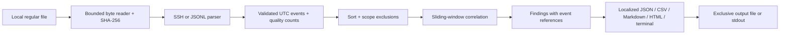

# AuthLens — Product specification

Design baseline: 2026-09-11. Target: 0.1.0, bounded offline authentication triage. Repository name and distribution availability are not verified; package locally until publication is explicitly requested.

## Problem and users

An analyst with an SSH log export needs to understand repeated failures, breadth across accounts, and a subsequent successful login without deploying a SIEM or handing logs to a service. The product turns a file into a reproducible investigation artifact. Users: students learning detection engineering, SOC analysts investigating a bounded export, administrators checking their own hosts.

Use cases: inspect an incident time window; compare a detection explanation with source line numbers; automate a triage gate using clean JSON and exit codes; demonstrate synthetic benign and suspicious behavior offline. Findings are investigation leads, never proof of stolen credentials or malicious actors.

## Non-goals

No live collection, blocking, credential attempts, networking, GeoIP, reputation, ML, arbitrary plugins, EVTX, arbitrary syslog dialects, VPN adapters, dashboard, multi-tenant service or full incident-response platform. No automatic attribution. No CVSS assigned to behavioral observations. No daemon or stdin in 0.1.0: bounded regular files make resource and evidence handling inspectable.

## Architecture and components



`config` validates a closed TOML schema; `parsers` normalize only known records; `ingest` enforces resource bounds and provenance; `engine` maintains window state; `models` defines immutable events and findings; `reporting` presents safe, localized evidence; `cli` coordinates and selects exit codes; `i18n` resolves catalogs; `safeio` protects input/output and log destinations. No detector imports CLI or exporters.

## Input contracts

`--input-format ssh` accepts two documented prefixes: ISO timestamp with explicit offset followed by hostname, or traditional `Mmm DD HH:MM:SS hostname`. Recognizes `sshd[pid]` or `sshd-session[pid]`, `Failed`/`Accepted`, `password`/`publickey`/`keyboard-interactive/pam`, optional `invalid user`, username, `from` IP, `port` valid TCP port and optional suffix. Other SSH messages count as ignored; authentication-looking unsupported records count as malformed. Traditional timestamps require `--year` and `--timezone ±HH:MM`; no implicit current year or local DST guess. Reject a year-wrap decrease for traditional logs instead of guessing. Mixed-year inputs must use ISO timestamps or JSONL.

`--input-format jsonl`: one JSON object per line, exactly `timestamp`, `host`, `service`, `username`, `source_ip`, `outcome`; outcome is `failure` or `success`. Timestamp requires ISO date and time with explicit UTC offset. Reject unknown/duplicate fields, arrays, null values, non-string values, controls and overlong identity fields. Service separates correlation domains. IP addresses are parsed and normalized, including IPv4-mapped IPv6; zone identifiers are unsupported. Unicode identities remain exact (no case folding or compatibility normalization). JSONL is a normalized interchange format, not a promise of native support for Windows/web/VPN exports.

## Data models

`Event`: stable ID derived from source SHA-256 + line number, UTC timestamp, host, service, username, source_ip, outcome, physical line number. No original raw line, password, public key, fingerprint or suffix is stored in reports.

`InputSummary`: source content SHA-256, byte/line counts, accepted, ignored, malformed, excluded, duplicate count, bounded diagnostics (line + machine error code only), completeness flag. Duplicate detection uses exact canonical event fields plus timestamp; first line is retained, counts expose discarded repetitions. This may merge genuine identical events at coarse timestamp precision; `--keep-duplicates` opts out.

`Finding`: stable ID, rule ID/version, severity, ordinal confidence, evidence_type `DERIVED`, classification `indicator`, start/end UTC, grouping key, event count, account count, bounded evidence event IDs + line/time/outcome/identity, evidence truncation boolean, localized title/explanation/hypothesis/recommendation/false-positive text, ATT&CK references, threshold parameters. Observation statistics are separate from inference and hypothesis. Confidence is qualitative, not a calibrated probability; severity is local triage priority, not CVSS.

`Report`: schema_version `1.0`, tool/version, generated_at UTC, report language, input summary, effective settings, sorted findings. JSON structural keys, IDs, enums, codes and technical strings never translate; human descriptions do. Running the same bytes/settings yields the same findings and IDs; generated_at differs intentionally.

## Detection rules (v1)

All windows are inclusive `[event_time-window, event_time]`, sorted by UTC timestamp then original line. Group by `(host, service, source_ip)`; user-specific rules also include exact username. Never correlate different hosts/services. Defaults: window 300 seconds, burst threshold 5 failures, breadth threshold 5 distinct accounts, success threshold 5 prior failures. Only one representative finding per rule/group per input: earliest threshold-reaching window. A single input may therefore omit later episodes; explicitly documented. Burst and breadth can both fire because they describe different properties.

| ID | Observation | Inference / confidence | Priority and rationale | Validation / false positives |
|---|---|---|---|---|
| AL-001 | At least 5 failures for one account/source/host/service within 300s | Repeated guessing is plausible / medium | MEDIUM: authentication friction worth checking, no success demonstrated | At threshold, below, inclusive edge, host/service split; stale automation and user retries |
| AL-002 | Failures across at least 5 accounts for one source/host/service within 300s | Multi-account pattern compatible with spraying / low | MEDIUM: breadth merits investigation, attempted passwords unknown | Distinct accounts, repeated same account, expired events; shared NAT, QA and broken SSO |
| AL-003 | Success after at least 5 failures for exact source/account/host/service within 300s | Potential access following repeated failures / medium | HIGH: successful access makes triage more urgent, compromise unproven | Success before/after/outside window, different account/host; legitimate recovery |

For every feature: problem and user are the triage cases above; delivered information is observations + data quality; automatic tests exercise thresholds and counterexamples; documentation includes rule semantics, limitations and recovery paths. No additional anomaly rules without a fixture corpus and measurable reason.

## CLI and outputs

```
authlens --help
authlens analyze examples/ssh-demo.log --input-format ssh --lang es
authlens analyze examples/events.jsonl --input-format jsonl --format json
authlens analyze examples/events.jsonl --format html --output report.html --lang zh-CN
authlens analyze examples/events.jsonl --config examples/config.toml --fail-on MEDIUM
authlens analyze legacy.log --input-format ssh --year 2026 --timezone=-03:00
```

Flags: `--lang`, `--config`, `--format {text,json,csv,markdown,html}`, `--output`, `--input-format`, `--window-seconds`, `--burst-threshold`, `--spray-threshold`, `--success-threshold`, `--exclude-cidr` (repeatable), `--exclude-user` (repeatable), `--keep-duplicates`, `--strict`, `--fail-on`, `--max-bytes`, `--max-events`, `--max-line-bytes`, `--year`, `--timezone`, `--log-file`, `-v/--verbose`, `-q/--quiet`, `--no-color`, `--version`. Global language/config work before or after subcommand. Text output has no ANSI styling, so no-color is a compatibility flag. No networking timeout/threads flags: they would be misleading.

stdout contains the selected report only (or localized help/version); stderr contains localized diagnostics. Quiet suppresses informational diagnostics, never errors or requested report. JSON remains parseable for partial success and fail-on findings. Codes: 0 complete without threshold breach; 1 finding at selected fail-on threshold; 2 usage/config; 3 I/O or input limit; 4 partial/malformed input or no usable events (report when possible); 130 cancellation. Completeness takes precedence over finding status. Default fail-on disabled: findings alone do not imply command failure.

JSON is authoritative and includes evidence and input quality. CSV is one row per finding with summary/provenance columns and JSON-encoded evidence; header-only when empty. Markdown, terminal and HTML include effective scope/settings and input quality even when no findings exist. HTML is self-contained, escaped, with restrictive CSP, no JavaScript/CDN/network resources. CSV cells beginning with formula/control characters are neutralized. Markdown escapes HTML, link delimiters and table delimiters. No exporter outputs raw input lines.

## Configuration and i18n

Single explicit UTF-8 TOML file with top-level keys matching supported settings; unknown keys are errors. Precedence: CLI > explicit config > defaults. Language: CLI > config `language` > first available LC_ALL/LC_MESSAGES/LANG or system locale > English. Locale normalization supports es_*, en_*, ru_* and zh_* to es/en/ru/zh-CN. Invalid explicit language is an error; unsupported OS language falls back. Catalogs shipped as package resources: en/es/ru/zh-CN JSON; tests require identical keys and formatting placeholders. Every CLI description, error and finding narrative comes from catalogs; machine codes are not translated. Python argparse diagnostic wrappers are localized without leaking source content. README translations cover the full onboarding and limitations; translation review by native speakers remains a release-quality consideration, not a claimed certification.

## Security and error model

Trust local logs as hostile data. Only regular files; no decompression, traversal, globbing, execution, network requests, dynamic loading or unsafe serialization. Reject symlink input when identifiable. Reader checks open-file metadata and growth/change, enforces byte/line/event limits incrementally, bounds diagnostic/evidence lists. Stop without a misleading final report on hard resource limits. No original input content in diagnostics/logs. Report identities and IPs are sensitive even without raw lines: owner controls storage/sharing.

Outputs/logs use exclusive create, never overwrite; reject conflicts with input/config or another output. File mode 0600 on POSIX; Windows relies on inherited directory ACLs. Writable destination directories are trusted: not a defense against a hostile local administrator changing directories. Input must be an immutable export for evidentiary use; hash proves content processed, not authenticity or chain of custody. Structured logs contain only lifecycle, counts and error codes, never paths or identity values. Interrupted/failed output creation removes only the newly created incomplete file.

## Performance

Read bounded bytes, parse in one pass, sort O(n log n), correlate O(n) using per-key deques and counters. Defaults 16 MiB file, 16 KiB line, 50,000 accepted records before deduplication, 20 evidence events per finding, 20 diagnostics. Maximum configurable file 256 MiB and events 500,000; hard limits are safeguards, not guaranteed RAM budgets. Findings <= 3n; report size bounded by event/finding/evidence limits but may amplify input. Benchmark a deterministic 10k-event synthetic workload with wall time and tracemalloc peak, record machine/runtime and avoid speed claims across machines. No premature parallelism.

## Testing and release acceptance

Unit: exact time semantics, malformed UTF-8/JSON, Unicode, IPv6, legacy dates, config ranges and languages. Integration: real files, duplicate quality, exclusions, scope boundaries, resource exhaustion, exclusive output. Detection oracle: seeded randomized streams compared with a simple independent brute-force predicate. E2E: subprocess entrypoint, all locales/formats, clean stdout, error codes, install from wheel into fresh environment, report escaping. Aim >80% meaningful coverage; do not claim coverage without a run.

CI: Python 3.11–3.14 on Ubuntu, Windows, macOS; lint/format, tests/coverage, build + wheel smoke install, Bandit, dependency audit, secret scanning. Pin action revisions to verified commits; minimum permissions, no remote publication by default. Manual/tag release workflow builds reviewed artifacts for GitHub Releases; actual remote creation/upload needs explicit publication authorization.

## Future extensions

Additional episodes per group, source adapters, event IDs from trusted collectors, pseudonymized exports and baseline comparison each require schema and threat-model review. EVTX needs native fixtures and documented event semantics. Geo/time anomalies require trustworthy timezone and asset context. No commitment to add all of them.
